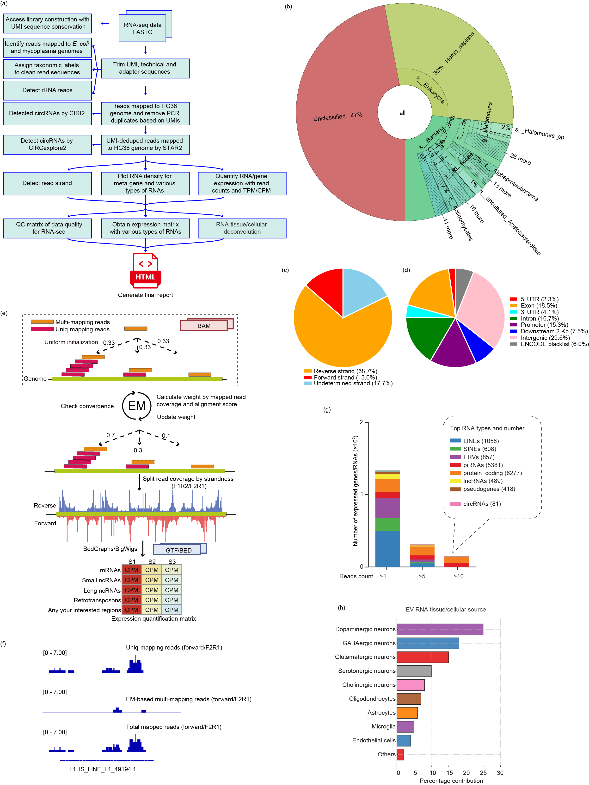

# EVscope: A Comprehensive Bioinformatics Workflow for Accurate and Robust Analysis of RNA Sequencing from Extracellular Vesicles

**EVscope** is an open-source, modular bioinformatics pipeline designed for extracellular-vesicle (EV) RNA sequencing data. It provides kit-aware processing for the SMARTer Stranded Total RNA-Seq Kit v3 (Pico Input) and the SMARTer smRNA-Seq Kit for Illumina. Select the protocol with `--kit smarter_total_rna` (the backward-compatible default) or `--kit smarter_smrna`. Tailored to EV RNA-seq challenges - low RNA yield, fragmented inserts, diverse RNA biotypes, high multi-mapping, and contamination risk - EVscope processes supported paired-end or single-end FASTQ inputs through an end-to-end workflow. It includes quality control, kit-appropriate duplicate handling, kit-specific STAR alignment, circular RNA detection, expression matrix generation, contamination screening, exploratory source-enrichment analysis, and comprehensive reporting. EVscope also introduces EMapper, an expectation-maximization (EM) module whose main EMapper-specific contribution is EM-weighted genome-coordinate BigWig/coverage generation with RNA annotation support; gene-level count concordance with featureCounts/RSEM is used as a sanity check, not as a claim that EMapper is superior to RSEM for conventional gene readcount quantification.

<p align="center">
  
</p>


## Table of Contents

- [Key Features](#key-features)
- [Motivation](#motivation)
- [Directory Structure](#directory-structure)
- [Requirements](#requirements)
- [Installation](#installation)
- [Usage](#usage)
- [Input Data Format](#input-data-format)
- [Pipeline Steps](#pipeline-steps)
- [Output Structure](#output-structure)
- [Troubleshooting](#troubleshooting)
- [FAQ](#faq)
- [Contributing](#contributing)
- [Feedback](#feedback)
- [Citation](#citation)
- [Credits](#credits)
- [License](#license)
- [Contact](#contact)

## Key Features

- **Kit-Aware Preprocessing**: Preserves the existing 14-bp UMI workflow for `smarter_total_rna`, while `smarter_smrna` uses the official SMARTer smRNA 5'/poly(A) trimming profile without UMI extraction or deduplication.
- **Novel Read-Through Detection for Total RNA**: Trims UMI-derived adapter sequences from Read1 using reverse-complemented Read2 UMIs (`bin/Step_03_UMIAdapterTrimR1.py`) when `--kit smarter_total_rna` is selected.
- **EM-Weighted BigWig Coverage Profiling**: Uses a genome-wide expectation-maximization algorithm to assign multi-mapped fragments at single-base or binned resolution and generate strand-aware, RPM-normalized BigWig tracks (`bin/Step_25_EMapper.py`).
- **Comprehensive RNA Annotation**: Supports 3,659,642 RNAs across 20 biotypes (e.g., protein-coding, lncRNAs, miRNAs, piRNAs, retrotransposons) from GENCODE v45, piRBase v3.0, and RepeatMasker.
- **Dual circRNA Detection**: Integrates CIRCexplorer2 and CIRI2 for circular RNA identification, with merged results (`bin/Step_10_circRNA_merge.py`); SMARTer smRNA libraries use the no-dedup reads and kit-specific STAR chimeric output.
- **Tissue Deconvolution**: Infers EV RNA cellular origins using GTEx v10 and Human Brain Cell Atlas v1.0 references (`bin/Step_22_run_RNA_deconvolution_ARIC.py`).
- **Contamination Screening**: Filters bacterial (BBSplit) and microbial (Kraken2) contamination, with optional genomic DNA correction via strand-specific subtraction.
- **Extensive Quality Control**: Validates raw and trimmed FASTQs (FastQC), generates a kit-aware library profile, and summarizes alignment metrics (`bin/Step_24_generate_QC_matrix.py`).
- **Expression Quantification**: Produces TPM/CPM matrices using featureCounts and RSEM, with RNA distribution visualizations (`bin/Step_15_plot_RNA_distribution_*.py`).
- **Interactive Reporting**: Generates bigWig tracks, density plots, a comprehensive HTML report via R Markdown (`bin/Step_27_html_report.Rmd`), and a separate one-paragraph RNA-seq summary covering read retention, human/E. coli/Mycoplasma mapping, alignment type, genomic regions, strand orientation, and the top 10 genes.
- **Reproducibility**: Single-command Bash script with Conda environments, containerization support, and detailed logging.

## Motivation

Extracellular vesicles (EVs) are critical mediators of intercellular communication, carrying diverse RNAs that serve as potential biomarkers for diseases like cancer and neurodegeneration. However, EV RNA sequencing faces unique challenges: low RNA abundance, fragmented transcripts, contamination from genomic DNA or bacterial RNA, and the presence of non-polyadenylated RNAs (e.g., miRNAs, lncRNAs). Standard RNA-seq pipelines, designed for cellular RNA, often fail to address these issues, leading to unreliable results due to multi-mapping reads, incomplete RNA annotations, or unfiltered contaminants.

EVscope provides a specialized, end-to-end pipeline with profiles for EV-enriched SMARTer Total RNA and SMARTer smRNA sequencing. Its distinctive contribution is not to replace transcript quantifiers such as RSEM for ordinary gene readcount estimation, but to connect kit-aware EV RNA preprocessing, broad RNA annotation, EM-weighted genome-coordinate BigWig tracks, RNA-biotype/meta-gene coverage profiling, and report generation in one reproducible workflow.

## Directory Structure

The EVscope repository is organized as follows:

```
EVscope/
├── EVscope.conf                                # Configuration file for tool and reference paths
├── EVscope.sh                                  # Main pipeline script (v1.1.0)
├── README.md                                   # This documentation
├── bin/                                        # Custom scripts for pipeline steps
│   ├── Step_02_calculate_ACC_motif_fraction.py  # Calculates ACC motif fractions
│   ├── Step_02_plot_fastq2UMI_motif.py         # Visualizes UMI motif distributions
│   ├── Step_03_plot_fastq_read_length_dist.py  # Plots read length distributions
│   ├── Step_03_UMIAdapterTrimR1.py             # Trims UMI-derived adapters
│   ├── Step_07_bam2strand.py                   # Determines library strandedness and splice/kb QC
│   ├── Step_08_convert_CIRCexplorer2CPM.py     # Normalizes CIRCexplorer2 circRNA output
│   ├── Step_09_convert_CIRI2CPM.py             # Normalizes CIRI2 circRNA output
│   ├── Step_10_circRNA_merge.py                # Merges circRNA results
│   ├── Step_13_gDNA_corrected_featureCounts.py # Generates gDNA-corrected counts
│   ├── Step_15_combine_total_RNA_expr_matrix.py # Combines RNA expression matrices
│   ├── Step_15_featureCounts2TPM.py            # Converts featureCounts to TPM
│   ├── Step_15_plot_RNA_distribution_1subplot.py  # RNA distribution plots (1 subplot)
│   ├── Step_15_plot_RNA_distribution_2subplots.py # RNA distribution plots (2 subplots)
│   ├── Step_15_plot_RNA_distribution_20subplots.py # RNA distribution plots (20 subplots)
│   ├── Step_15_plot_top_expressed_genes.py     # Plots top expressed genes
│   ├── Step_17_RSEM2expr_matrix.py             # Converts RSEM to expression matrix
│   ├── Step_18_plot_reads_mapping_stats.py     # Visualizes genomic region mapping
│   ├── Step_22_run_RNA_deconvolution_ARIC.py   # Performs tissue deconvolution
│   ├── Step_24_generate_QC_matrix.py           # Compiles QC metrics
│   ├── Step_25_bigWig2Expression.py            # Converts bigWig to CPM/TPM
│   ├── Step_25_EMapper.py                      # EM-based read coverage estimation
│   ├── Step_26_density_plot_over_meta_gene.sh  # Density plots for meta-gene regions
│   ├── Step_26_density_plot_over_RNA_types.sh  # Density plots for RNA types
│   ├── Step_27_generate_summary_report.py      # Generates standalone concise summary
│   └── Step_27_html_report.Rmd                 # Generates comprehensive HTML report
├── figures/                                    # Pipeline visualization
│   └── EVscope_pipeline.png                    # Pipeline overview image
├── references/                                 # Reference genomes, annotations, and indices
│   ├── annotations_HG38/                       # Human genome annotations
│   ├── deconvolution_HG38/                     # Deconvolution reference matrices
│   ├── genome/                                 # Reference genomes
│   └── index/                                  # Aligner indices
└── soft/                                       # Bundled external tools
    ├── bbmap                                   # BBMap tools
    ├── CIRI_v2.0.6                             # CIRI2 for circRNA detection
    ├── kraken2                                 # Kraken2 for taxonomic classification
    ├── KrakenTools                             # Kraken2 helper scripts
    └── RSEM_v1.3.3                             # RSEM for quantification
```

## Requirements

### Software
- **Operating System**: Linux (e.g., Ubuntu 20.04+) or macOS.
- **Bash**: Version 4.0 or higher.
- **Conda**: Miniconda or Anaconda for environment management.
- **Core Tools**:
  - FastQC (v0.12.1), umi_tools (v1.1.5), cutadapt (v4.9)
  - STAR (v2.7.11b), samtools (v1.21), featureCounts (v2.0.6)
  - CIRCexplorer2 (v2.3.8), CIRI2 (v2.0.6), RSEM (v1.3.3)
  - BBMap (v39.15), Kraken2, ribodetector (v0.3.1)
  - seqtk (v1.4), BWA (v0.7.18), Picard (v3.3.0), deepTools (v3.5.5)
  - R (v4.3.1) with rmarkdown, DT, kableExtra, bookdown, ggplot2, dplyr
  - Python (v3.10.0) with pandas, numpy, matplotlib, biopython, numba, pyBigWig, pysam

### Hardware
- **CPU**: 20+ threads recommended for optimal performance.
- **RAM**: Minimum 64 GB; 250 GB recommended for Picard tools.
- **Storage**: 500 GB+ for input data, references, and outputs.

## Installation

1. **Clone the Repository**:
   ```bash
   git clone https://github.com/TheDongLab/EVscope.git
   cd EVscope
   ```

2. **Install Conda** (if not already installed):
   ```bash
   wget https://repo.anaconda.com/miniconda/Miniconda3-latest-Linux-x86_64.sh
   bash Miniconda3-latest-Linux-x86_64.sh
   source ~/.bashrc
   ```

3. **Create Conda Environments**:
   ```bash
   conda env create -f environments/evscope_env.yml
   conda env create -f environments/picard_env.yml
   conda env create -f environments/kraken2_env.yml
   ```

4. **Install CIRCexplorer2**:
   ```bash
   conda activate evscope_env
   pip install CIRCexplorer2==2.3.8
   ```

5. **Download Reference Files**:
   Reference annotation files (HG38, GENCODE v45) are available on [Zenodo](https://doi.org/10.5281/zenodo.15577788). Download `EVscope_annotations_HG38.zip` and extract to `references/annotations_HG38/`.

6. **Test Installation**:
   ```bash
   conda activate evscope_env
   fastqc --version
   STAR --version
   samtools --version
   python --version
   ```

## Smoke Test

A lightweight repository smoke test is available under `tests/smoke/`. It validates script syntax, kit-aware CLI behavior, summary-report logic, and selected synthetic-data transformations without requiring the full human reference bundle. The SMARTer smRNA pipeline checks use test doubles for cutadapt, STAR, and samtools; they verify trimming fixtures and command routing, rather than alignment accuracy on biological data.

```bash
bash tests/smoke/run_smoke.sh
```

For a full end-to-end run, download the Zenodo reference bundle and use the SRA example listed in Data Availability.

## Usage

### Command Syntax

```bash
bash EVscope.sh --sample_name <name> --input_fastqs <files> [--kit <kit>] [options]
```

**Required Arguments**:

- `--sample_name <name>`: Unique sample identifier (used for output files).
- `--input_fastqs <files>`: FASTQ file paths. Both kit profiles accept one single-end file or two paired-end files. Paired-end inputs may be space-separated (`R1.fq.gz R2.fq.gz`) or comma-separated (`R1.fq.gz,R2.fq.gz`), with R1 first.

**Optional Arguments**:

| Option | Description | Default |
|--------|-------------|---------|
| `--threads <int>` | Number of CPU threads | 1 |
| `--kit <kit>` | Library kit (`smarter_total_rna` or `smarter_smrna`) | `smarter_total_rna` |
| `--run_steps <list>` | Steps to run (e.g., `1,3,5-8`, `all`) | `all` |
| `--skip_steps <list>` | Steps to skip (e.g., `2,4`) | None |
| `--circ_tool <tool>` | circRNA detection tool (`CIRCexplorer2`, `CIRI2`, `both`) | `both` |
| `--gDNA_correction <yes\|no>` | Apply genomic DNA correction | `no` |
| `--strand <strand>` | Library strandedness (`forward`, `reverse`, `unstrand`); when omitted for `smarter_smrna`, R1 is treated as sense and `forward` is selected | `unstrand` for Total RNA; `forward` for smRNA |
| `--config <path>` | Custom configuration file | `EVscope.conf` |
| `--resume` | Resume an existing output directory only when step metadata match current inputs/config/parameters | off |
| `--force` | Allow re-running selected steps in an existing output directory | off |
| `--dry-run` | Validate inputs/config/dependencies and print execution plan without running steps | off |
| `-V, --verbosity <level>` | Logging level (1=DEBUG, 2=INFO, 3=WARN, 4=ERROR, 5=FATAL) | 2 |
| `-h, --help` | Display help message | - |
| `-v, --version` | Show pipeline version | - |

**Resume behavior**: EVscope refuses to reuse a non-empty output directory unless `--resume` or `--force` is provided. `--resume` only skips steps whose `step.meta.json` matches the current inputs, configuration, pipeline version, and parameters including `--kit`. EVscope v1.1 adds the kit to the run signature, so output directories created by v1.0 have incompatible signatures and must be regenerated with `--force` (or removed and rerun); they cannot be safely resumed with v1.1.

**Report R environment**: Step 27 can render through a configured Conda R environment. Set `REPORT_R_ENV` in `EVscope.conf` to a Conda R environment name (for example, `r_env_4.4.3`) and, if needed, `CONDA_EXE` to the Conda executable. The default public config leaves `REPORT_R_ENV` empty and uses `Rscript` from `PATH`.

**Local configuration**: Copy `EVscope.conf` to `EVscope.local.conf`, set your installation and reference paths there, and pass `--config EVscope.local.conf`. This local file and sample output directories (`*_EVscope_output/`) are ignored by Git. The public configuration uses placeholder paths; committed FASTQ fixtures contain synthetic reads only.

**STAR parameter injection**: Step 6 reads STAR options from Bash arrays in `EVscope.conf`. `STAR_COMMON_ARGS` applies to all libraries; `STAR_TOTAL_RNA_ARGS`, `STAR_SMRNA_SE_ARGS`, and `STAR_SMRNA_PE_ARGS` define the protocol profiles. Add new options to `STAR_EXTRA_ARGS`, `STAR_TOTAL_RNA_EXTRA_ARGS`, or `STAR_SMRNA_EXTRA_ARGS`. Keep each option and value as separate array elements, for example `STAR_SMRNA_EXTRA_ARGS=(--limitBAMsortRAM 30000000000)`. To change an option already present, edit it in its profile array instead of adding the same option again. Input/output paths, threads, run mode, sorting threads, and refined-run gene counting remain pipeline-controlled.

### Example: SMARTer Stranded Total RNA-Seq Kit v3

```bash
bash EVscope.sh --sample_name Total_RNA_Example \
    --input_fastqs R1.fq.gz R2.fq.gz \
    --kit smarter_total_rna \
    --threads 20 \
    --run_steps all \
    --gDNA_correction yes \
    --strand reverse \
    --verbosity 2
```

Omitting `--kit` gives the same `smarter_total_rna` behavior for backward compatibility.

### Example: SMARTer smRNA-Seq Kit for Illumina

```bash
bash EVscope.sh --sample_name smRNA_Example \
    --input_fastqs R1.fq.gz R2.fq.gz \
    --kit smarter_smrna \
    --threads 20 \
    --run_steps all \
    --verbosity 2
```

In this example `--strand` is intentionally omitted, so EVscope uses `forward` because SMARTer smRNA R1 is the sense read.
Steps 8-10 remain available for this kit. EVscope runs circRNA detection on the no-dedup processed reads and retains STAR chimeric-junction output for CIRCexplorer2. Because the library's 3'-polyadenylation workflow is not optimized for intact circRNA capture, interpret circRNA calls cautiously and validate important back-splice junctions independently.

## Input Data Format

- **FASTQ files**: Gzipped FASTQ input with R1 listed first whenever paired-end input is permitted.
- **Quality**: High-quality reads suitable for EV RNA-seq.

| Kit | `--kit` value | Accepted input | Orientation and default strand | Steps 2-3 and duplicate handling |
|-----|---------------|----------------|--------------------------------|--------------------------------|
| SMARTer Stranded Total RNA-Seq Kit v3 (Pico Input) | `smarter_total_rna` | Single-end or paired-end; paired-end requires R1 then R2 | Existing strand behavior; default `unstrand` | Existing UMI/ACC profiling and 14-bp UMI workflow, adapter and Q20 trimming, read-through UMI removal, and UMI-based deduplication |
| SMARTer smRNA-Seq Kit for Illumina | `smarter_smrna` | Single-end R1 or paired-end R1/R2 | R1 is sense; if `--strand` is omitted, EVscope selects `forward` | R1 uses `-u 3` and poly(A) trimming. For PE data, R2 uses a fixed 14-nt 5' poly(T) trim and removes `NNNAGATCGGAAGAGC` from the 3' end. Reads shorter than 15 nt are discarded, Q20 trimming is applied to both mates, no UMI deduplication is performed, and circRNA Steps 8-10 operate on no-dedup reads. |

The SMARTer smRNA profile follows Takara Bio's official [supplemental product information and data-processing guidance](https://catalog.takara-bio.co.jp/PDFS/SMARTer_smRNA-Seq_Kit_for_Illumina.pdf). Takara's [read-trimming FAQ](https://help.takarabio.com/36168/kb/article/109694/do-i-have-to-perform-any-nucleotide-trimming-of-the-smarter-smrnasequencing-reads-prior-to-mapping) explains the R1 5' three-nucleotide and 3' poly(A) trimming requirements, and its [UMI FAQ](https://help.takarabio.com/36168/kb/article/109681) confirms that SMARTer smRNA libraries do not incorporate UMIs. The PE extension uses the observed complementary R2 structure: 14 technical 5' bases, reverse-complement insert, three template-switch-derived bases, then the Illumina adapter.
Because this protocol introduces an artificial poly(A) tract, EMapper's biological poly(A)-tail detection is disabled under `smarter_smrna`.

## Pipeline Steps

| Step | Description |
|------|-------------|
| 1 | Raw FASTQ quality control using FastQC |
| 2 | Kit-aware library profiling: UMI motif/ACC analysis for `smarter_total_rna`, or a no-UMI library profile for `smarter_smrna` |
| 3 | Kit-aware preprocessing: existing UMI extraction, adapter trimming, and read-through removal for Total RNA; official 5'/poly(A) trimming followed by Q20 trimming for smRNA |
| 4 | Quality control of trimmed FASTQs |
| 5 | Bacterial contamination screening (E. coli, Mycoplasma) using BBSplit |
| 6 | Kit-aware STAR alignment: Total RNA retains two-pass/splice/chimeric alignment and UMI deduplication; smRNA uses end-to-end, unspliced short-read alignment with absolute match thresholds and no UMI deduplication |
| 7 | Library strandedness detection; splice/kb complementary gDNA-contamination QC proxy (primary source: STAR Log.final.out from Step 6) |
| 8 | CIRCexplorer2-based circular RNA detection |
| 9 | CIRI2-based circular RNA detection using BWA alignments |
| 10 | Merging of CIRCexplorer2 and CIRI2 circRNA results |
| 11 | RNA-seq metrics collection using Picard |
| 12 | featureCounts quantification (unique-mapping mode) |
| 13 | Genomic DNA-corrected featureCounts quantification |
| 14 | RSEM quantification (multi-mapping mode) |
| 15 | featureCounts-based expression matrix and RNA distribution plots |
| 16 | gDNA-corrected expression matrix |
| 17 | RSEM-based expression matrix |
| 18 | Genomic region read mapping analysis |
| 19 | Taxonomic classification using Kraken2 |
| 20-22 | Tissue deconvolution (featureCounts, gDNA-corrected, RSEM) |
| 23 | rRNA detection using ribodetector |
| 24 | Comprehensive quality control summary generation |
| 25 | Coverage analysis and bigWig generation using EMapper |
| 26 | Coverage density plots for RNA types and meta-gene regions |
| 27 | Final interactive HTML report plus a separate concise RNA-seq summary report |

**splice/kb interpretation.** EVscope reports splice junction crossings per kilobase of uniquely mapped aligned sequence as a complementary genomic-DNA-contamination QC proxy. For paired-end STAR logs, the denominator uses both mates' uniquely mapped aligned bases per fragment/read-pair, not insert size: `splice/kb = Number of splices: Total x 1000 / (Uniquely mapped reads number x Average mapped length)`. In an in-house EV RNA-seq pilot using EXODUS-M isolation, miRNeasy Advanced extraction and 400 uL plasma input (N=5), the single no-DNase control had splice/kb = 0.13; the TURBO DNase pilot libraries had splice/kb values of 1.67 (0.5 U, 10 min), 0.63 (0.25 U, 10 min), 1.64 (0.5 U, 5 min), and 0.94 (0.25 U, 5 min). Values closer to the no-DNase pilot value may indicate higher residual genomic-DNA-derived contribution, whereas higher values are directionally compatible with increased spliced/transcript-derived signal after DNase treatment. These empirical values are exploratory reference guides, not universal cutoffs and not a direct DNA quantification assay.

## Output Structure

Each sample generates an output directory with the following structure:

```
<sample_name>_EVscope_output/
├── Step_01_Raw_QC/                    # FastQC reports for raw reads
├── Step_02_UMI_Analysis/              # Kit-aware library profile; UMI/ACC only for Total RNA
├── Step_03_UMI_Adaptor_Trim/          # Kit-aware trimming and clean FASTQs
├── Step_04_Trimmed_QC/                # FastQC reports for trimmed reads
├── Step_05_Bacterial_Filter/          # BBSplit bacterial/mycoplasma screening
├── Step_06_Alignment_Initial/         # Initial STAR alignment and kit-appropriate duplicate handling
├── Step_06_Alignment_Refined/         # Refined STAR alignment and final BAM
├── Step_07_Strand_Detection/          # Strandedness and splice/kb metrics
├── Step_08_CIRCexplorer2_circRNA/     # CIRCexplorer2 circRNA results
├── Step_09_CIRI2_circRNA/             # CIRI2 circRNA results
├── Step_10_circRNA_Merge/             # Merged circRNA results (CPM-normalized)
├── Step_11_RNA_Metrics/               # Picard RNA-seq metrics
├── Step_12_featureCounts_Quant/       # featureCounts gene quantification
├── Step_13_gDNA_Corrected_Quant/      # gDNA-corrected quantification
├── Step_14_RSEM_Quant/                # RSEM quantification
├── Step_15_featureCounts_Expression/  # Expression matrices (TPM/CPM)
├── Step_16_gDNA_Corrected_Expression/ # gDNA-corrected expression matrices
├── Step_17_RSEM_Expression/           # RSEM expression matrices
├── Step_18_Genomic_Regions/           # Meta-gene region mapping stats
├── Step_19_Taxonomy/                  # Kraken2 taxonomic classification
├── Step_20-22_Deconvolution/          # Tissue deconvolution results
├── Step_23_rRNA_Detection/            # ribodetector rRNA detection
├── Step_24_MultiQC_Summary/           # QC summary matrix
├── Step_25_EMapper_BigWig_Quantification/ # EMapper coverage and bigWig
├── Step_26_BigWig_Density_Plot/       # RNA type and meta-gene density plots
├── Step_27_HTML_Report/               # Detailed and standalone concise HTML reports
└── EVscope_pipeline.log               # Pipeline execution log
```

The historical Step 2, Step 3, and Step 6 directory names are retained for output-path compatibility. Under `smarter_smrna`, Step 2 contains the smRNA library profile, Step 3 contains the trimmed/clean R1 and, for PE input, R2, while Step 6 does not perform UMI extraction or UMI-based deduplication. UMI/ACC and read-through-specific files are produced only by `smarter_total_rna`.

For `smarter_smrna`, STAR is run with end-to-end, unspliced alignment (`--alignEndsType EndToEnd`, `--alignIntronMax 1`) and at most one mismatch. The normalized score/match filters are disabled and replaced with absolute floors derived from the 15-nt post-trimming minimum: 12 alignment-score and 14 matched bases per mate (24/28 for PE). Equally best multi-mapping loci are retained, up to the existing limit of 100, because many short ncRNAs are not uniquely mappable. Two-pass alignment remains disabled, while chimeric-junction output is enabled for the circRNA workflow.

## Troubleshooting

- **Dependency Not Found**: Verify Conda environments with `conda list -n evscope_env`.
- **Reference File Missing**: Check `EVscope.conf` paths and file existence.
- **Memory Issues**: Picard requires up to 250 GB RAM. Reduce `--threads` or use a high-memory server.
- **Step Failure**: Review logs in `<output_dir>/EVscope_pipeline.log`.

## FAQ

**Q: Which library kits are supported?**
A: Use `--kit smarter_total_rna` for the SMARTer Stranded Total RNA-Seq Kit v3 (the default) or `--kit smarter_smrna` for the SMARTer smRNA-Seq Kit for Illumina. Other library protocols are not represented by these profiles and require separately validated preprocessing.

**Q: Can `smarter_smrna` process paired-end FASTQs?**
A: Yes. Provide R1 first and R2 second. R1 is trimmed with the official `-u 3`/poly(A) profile. R2 is trimmed by 14 nt at its 5' poly(T) end and by the `NNNAGATCGGAAGAGC` structure at its 3' end. Both mates remain synchronized and are passed to paired-end alignment without UMI deduplication.

**Q: How does EVscope preprocess SMARTer smRNA reads?**
A: R1 is treated as the sense read. Step 2 records a no-UMI library profile. Step 3 applies `cutadapt -m 15 -u 3 -a AAAAAAAAAA`, followed by the existing Q20 quality trimming. It does not run UMI extraction, UMI read-through removal, or UMI-based deduplication. Steps 8-10 can detect circRNAs from the no-dedup reads, although calls from this 3'-polyadenylation protocol should be interpreted cautiously.

**Q: Do I need to specify `--strand forward` for SMARTer smRNA?**
A: No. If `--strand` is omitted with `--kit smarter_smrna`, EVscope selects `forward`. An explicitly supplied `--strand` value is honored.

**Q: Can I resume a v1.0 output directory with EVscope v1.1?**
A: No. v1.1 includes the kit and pipeline version in step signatures. Use `--force` to regenerate the selected steps, or remove the old output directory and start a fresh run.

**Q: How do I run specific pipeline steps?**
A: Use `--run_steps`, e.g., `--run_steps 1,3,5-8`.

**Q: How do I view the final report?**
A: Open `Step_27_HTML_Report/<sample_name>_final_report.html` for the comprehensive report, or `<sample_name>_summary_report.html` in the same directory for the standalone one-paragraph summary.

## Contributing

We welcome contributions! To contribute:
1. Fork the repository: [https://github.com/TheDongLab/EVscope](https://github.com/TheDongLab/EVscope).
2. Create a feature branch: `git checkout -b feature/YourFeature`.
3. Submit a pull request.

Please report bugs via [GitHub Issues](https://github.com/TheDongLab/EVscope/issues).

## Citation

If you use EVscope in your research, please cite:

> Zhao, Yiyong, et al. "EVscope: A Comprehensive Bioinformatics Pipeline for Accurate and Robust Analysis of Total RNA Sequencing from Extracellular Vesicles." bioRxiv (2025). Zenodo: https://doi.org/10.5281/zenodo.15577788

## Credits

**Authors**:
- **Yiyong Zhao**: Data curation, Formal analysis, Software, Visualization
- **Himanshu Chintalapudi**: Visualization
- **Ziqian Xu**: Resources
- **Weiqiang Liu**: Data curation
- **Yuxuan Hu**: Validation
- **Ewa Grassin**: Resources [supporting]
- **Xianjun Dong**: Conceptualization, Methodology, Funding, Supervision

**Affiliations**:
1. Stephen & Denise Adams Center for Parkinson's Disease Research of Yale School of Medicine, New Haven, CT 06510, USA
2. Department of Neurology, Yale School of Medicine, Yale University, New Haven, CT 06510, USA
3. Aligning Science Across Parkinson's (ASAP) Collaborative Research Network, Chevy Chase, MD 20815, USA
4. Department of Medicine, Brigham and Women's Hospital, Harvard Medical School, Harvard University, Boston, MA, USA

**Data Availability**:
Source code: [https://github.com/TheDongLab/EVscope](https://github.com/TheDongLab/EVscope) and Zenodo (https://doi.org/10.5281/zenodo.15577788), licensed under the MIT License.
Raw sequencing data: NCBI SRA (accession: SRR31350808-SRR31350811).

**Corresponding Author**: Xianjun Dong ([xianjun.dong@yale.edu](mailto:xianjun.dong@yale.edu))

## License

EVscope source code is licensed under the [MIT License](LICENSE).

## Contact

- **Xianjun Dong**: [xianjun.dong@yale.edu](mailto:xianjun.dong@yale.edu)
- **GitHub**: [https://github.com/TheDongLab/EVscope](https://github.com/TheDongLab/EVscope)
