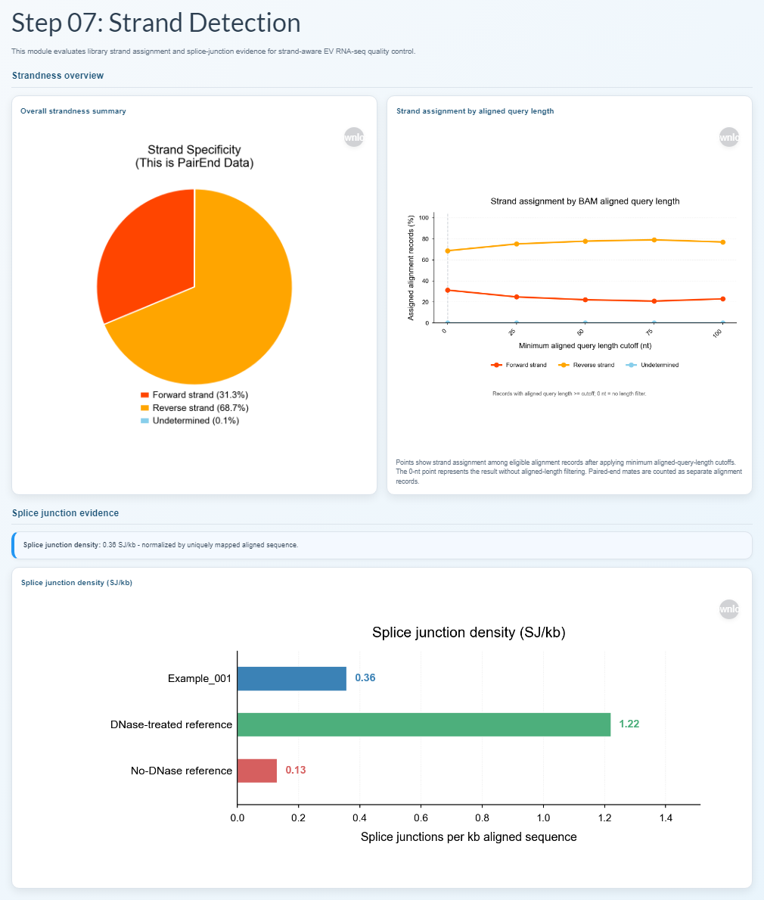
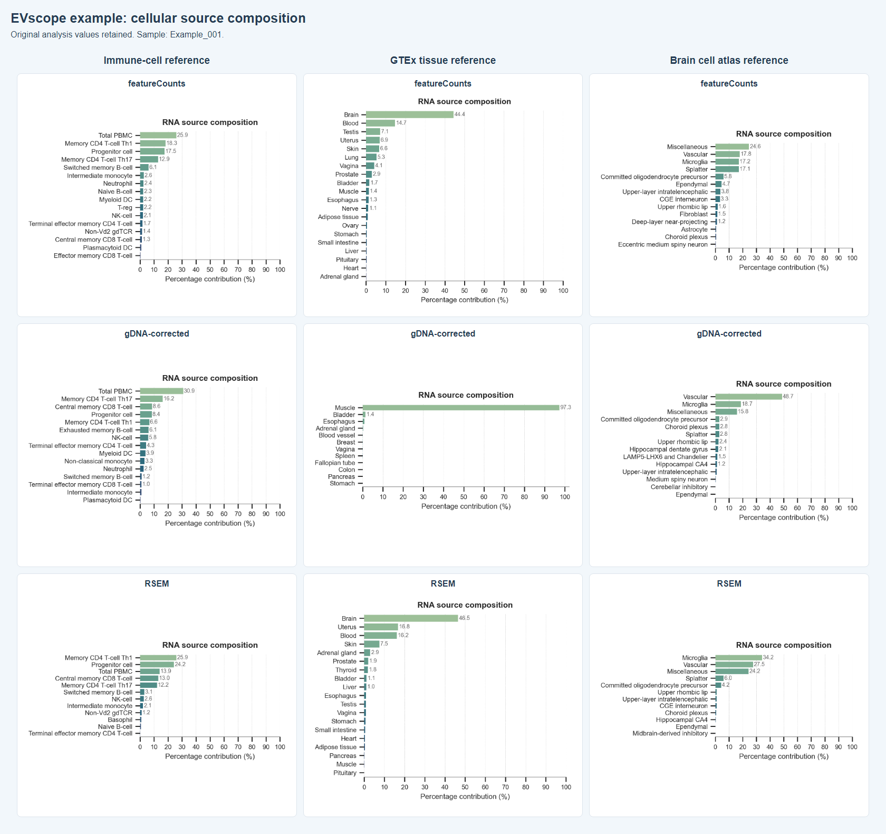

# Visual example

This folder contains an anonymized report from a paired-end SMARTer Stranded Total RNA-Seq analysis. It includes UMI motif and read-through trimming QC, initial and post-UMI-deduplication alignment, insert-size distribution, circRNA results, expression figures, taxonomy, cellular-source composition, and coverage profiles.

The report contains 33 main figures, 5 embedded reports, and 8 interactive tables. Nine cellular-source figures cover immune-cell, GTEx tissue, and brain cell atlas references across featureCounts, gDNA-corrected, and RSEM estimates.

| File | Description |
| --- | --- |
| [EVscope_example_report.html](EVscope_example_report.html) | Self-contained interactive HTML report, about 51 MiB. |
| [report_preview.png](report_preview.png) | Screenshot of strandness and splice-junction QC. |
| [deconvolution_preview.png](deconvolution_preview.png) | Comparison of the nine cellular-source figures included in the report. |
| [validation.json](validation.json) | Identifier, numerical-content, image, embedded-report, and offline-browser checks. |
| [bigwig/](bigwig/) | Two downloadable chromosome-1 strand BigWig tracks, approximately 1.4-1.5 MB each, with interval-preservation validation. |

To view the complete report, open the HTML file on GitHub, click **Download raw file**, and open the downloaded file in a browser. A repository clone also contains everything needed for offline viewing.

Names, project/sample identifiers, sequencing file identifiers, private filesystem paths, and run dates/times have been removed or replaced, including identifiers in embedded reports, figure labels, and downloadable images. The example uses the sample identifier `Example_001`.

Original analysis values, gene and species names, sequence content, public software versions, and license information are retained. For raster figures, only identifying label regions were edited; pixels outside those regions were verified unchanged. This example contains real analysis results. The source report was left unchanged, and no original-to-example identifier mapping is included.

The [chromosome-1 BigWig downloads](bigwig/) preserve the original F1R2/F2R1 alignment-orientation groups and coverage values. Load both tracks using the matching GRCh38/hg38 reference. Other chromosomes are excluded to keep the example compact.

File integrity is recorded in [the repository checksum list](../repro/checksums.sha256) and [artifact manifest](../repro/manifest.tsv).

